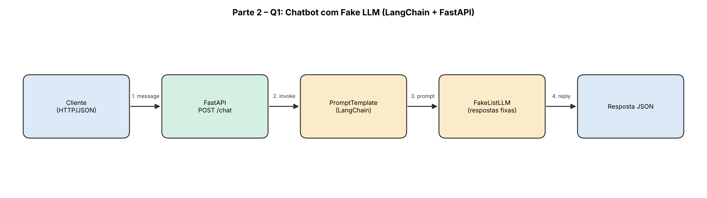

# Parte 2 – Questão 1: Chatbot simples com Fake LLM (LangChain + FastAPI)

Protótipo de chatbot que recebe uma mensagem via FastAPI e devolve uma resposta simulada por um **Fake LLM** (`FakeListLLM` do LangChain), sem chamadas de rede nem custo.

## Estrutura

```
parte2-q1-langchain-fake-llm/
├── app/
│   ├── __init__.py
│   ├── chatbot.py     # PromptTemplate + FakeListLLM (cadeia LCEL)
│   ├── main.py        # aplicação FastAPI
│   └── schemas.py
├── docs/
│   └── arquitetura.png
├── tests/
│   └── test_api.py
├── pytest.ini
├── requirements.txt
└── README.md
```

## Como executar

```bash
python -m venv .venv
source .venv/bin/activate        # Windows: .venv\Scripts\activate
pip install -r requirements.txt
uvicorn app.main:app --reload
```

Documentação interativa: http://127.0.0.1:8000/docs

## Exemplo de uso

```bash
curl -X POST http://127.0.0.1:8000/chat \
  -H "Content-Type: application/json" \
  -d '{"message": "Qual o horário de atendimento?"}'
```

```json
{
  "message": "Qual o horário de atendimento?",
  "reply": "Olá! Sou um chatbot de demonstração. Como posso ajudar?",
  "llm": "FakeListLLM"
}
```

As respostas pré-definidas (em `app/chatbot.py`) são devolvidas em ordem circular, uma por chamada.

## Arquitetura



Fluxo: Cliente → FastAPI (`/chat`) → PromptTemplate → FakeListLLM → resposta JSON.

## Por que usar Fake LLM?

- **Rapidez:** respostas instantâneas, sem latência de rede ou de inferência.
- **Custo zero:** não consome tokens nem exige chave de API.
- **Determinismo:** a mesma sequência de respostas facilita testes automatizados.
- **Isolamento:** permite validar a estrutura da aplicação (rotas, validação, cadeia) antes de integrar um LLM real, bastando trocar o `FakeListLLM` por outro modelo.

## Testes

```bash
pytest -q
```
